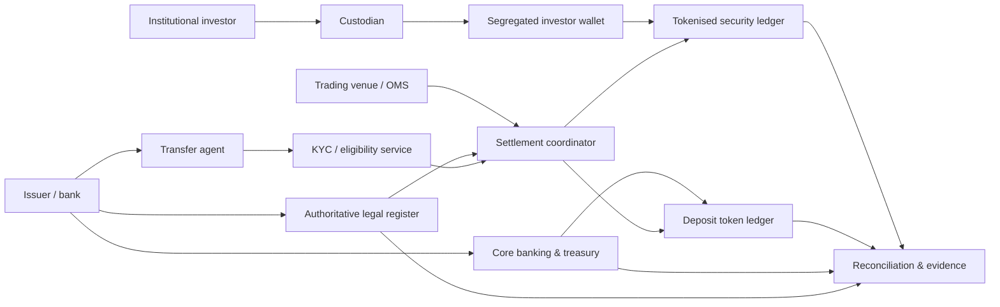
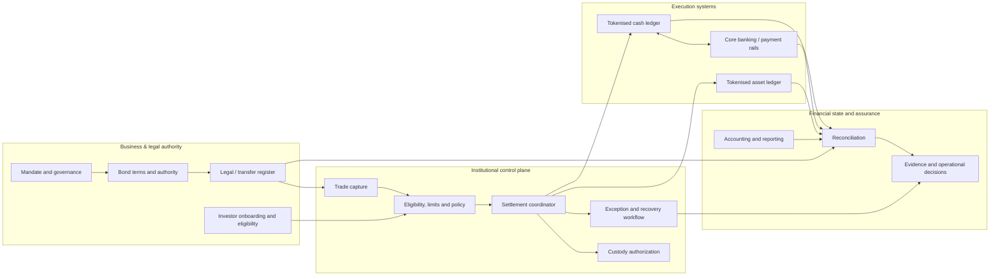
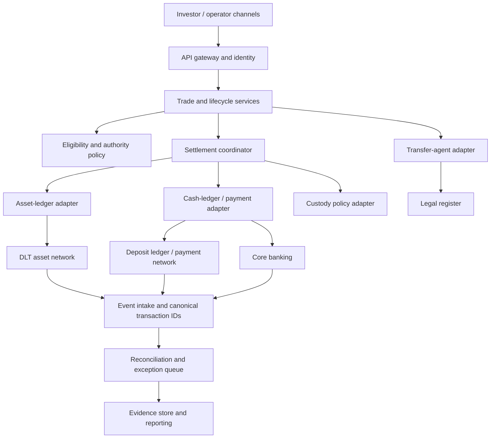
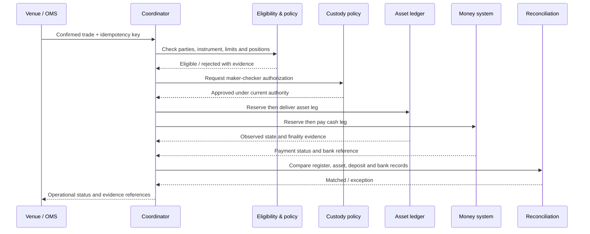
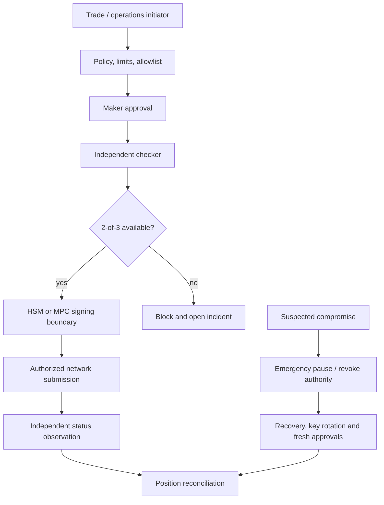
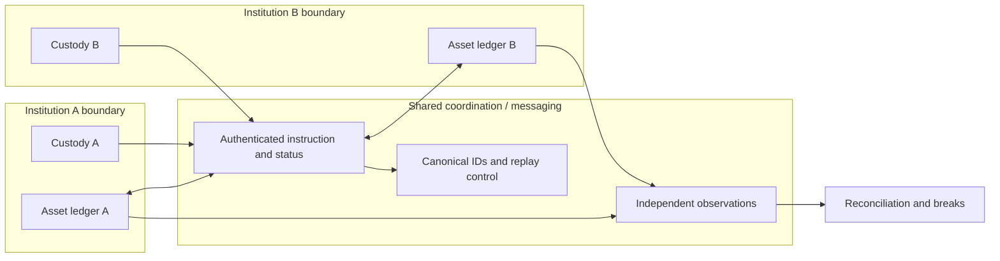
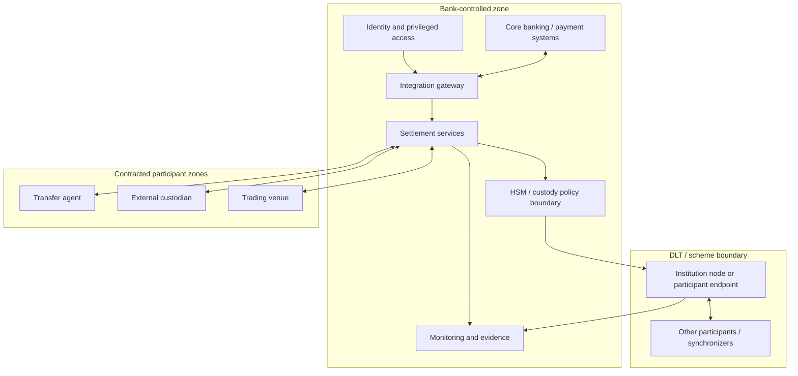

# Enterprise reference architecture

This reference describes a European financial institution's synthetic €100M bond and tokenised-deposit workflow. It separates rights, records and operational controls. The architecture is illustrative: boxes do not imply deployed systems or integrations.

## 1. Ecosystem and actors

## 2. End-to-end target architecture

## 3. Application and component architecture

Adapters above are conceptual; this repository implements none of them. ISO 20022 mappings should preserve business identifiers, parties, amounts, status and references rather than treating a message acknowledgement as settlement finality.

## 4. Asset and cash settlement sequence

For coordinated systems, steps can produce an intermediate state; a failed cash leg does not prove atomic rollback. Only claim atomic DvP if one legally and technically defined mechanism covers both obligations.

## 5. Tokenised securities lifecycle

```mermaid
stateDiagram-v2
  [*] --> Designed
  Designed --> Authorized: terms, authority, governing law
  Authorized --> Registered: register and agent appointed
  Registered --> Issued: supply and token controls reconciled
  Issued --> Distributed: subscription and investor eligibility
  Distributed --> Held: custody and wallet allocation
  Held --> Traded: matched secondary trade
  Traded --> Settled: asset and cash obligations completed
  Settled --> Serviced: coupon / corporate action
  Serviced --> Held
  Settled --> Redeemed: maturity and redemption paid
  Redeemed --> Closed: token cancelled; register updated
```

Legal ownership, beneficial entitlement, token representation and operational ledger state are separate concepts. Issuance, transfer, servicing and redemption must be reconciled to the applicable legal instrument and register rules.

## 6. Institutional custody architecture

Separate treasury, operational and client wallets; set authority by role and transaction limit. Recovery, signer independence, backups, key rotation and business continuity require tested procedures. This diagram specifies no production cryptographic scheme.

## 7. Multi-ledger interoperability

Interoperability can mean common APIs, messaging, shared coordination, atomic synchronisation or a bridge. Those mechanisms have different trust and finality properties. Do not infer cross-ledger atomicity from message delivery.

## 8. Deployment and trust boundaries

Classify data, minimize outbound fields, authenticate all boundaries and record external dependencies. Deployment regions, availability objectives, recovery time and recovery point objectives are institution-specific and intentionally not fabricated here.

## Digital money and settlement models

| Model | Liability / account | Ledger relationship | Key operational questions |
|---|---|---|---|
| Deposit mirror | Customer bank deposit | Core banking remains authoritative; token balance mirrors a controlled position | How are holds, transfers, redemption, reversals and ledger divergence synchronized? |
| Omnibus deposit | Bank deposit in pooled account | Tokenised subledger assigns positions against pooled funds | Who owns the account claim; how are beneficial entitlements, insolvency treatment and breaks handled? |
| Wholesale CBDC / reserves | Central bank money, subject to scheme | Access-controlled central-bank-money representation | Which institutions may hold it, during what hours, under which scheme and legal rules? |
| Regulated stablecoin | Issuer liability backed under its framework | Token ledger and issuer reserve/redemption records | Reserve quality, redemption access, issuer and settlement exposure? |
| Existing payment rails | Existing account and payment claims | Cash leg remains on established payment infrastructure | How are timing gaps, irrevocability, liquidity and failed-leg recovery handled? |

No model universally provides legal finality or suits all institutions. Payment-versus-payment and delivery-versus-payment need an explicit rulebook and settlement mechanism that cover the linked obligations.

## DLT qualitative selection matrix

| Profile | Privacy / visibility | Permissioning & identity | Governance / operations | Contract and interoperability considerations |
|---|---|---|---|---|
| Besu | Ethereum-style shared state; privacy depends on architecture | Configurable private-network and node permissioning | Consortium configuration, node operations and upgrades | EVM contracts; integration with Ethereum tooling; no assumed legal finality |
| Fabric | Permissioned channels and private data collections | Membership Service Providers and organizational identities | Endorsement, channel and peer governance create operational choices | Chaincode model; cross-channel visibility is constrained by design |
| Canton | Contract visibility is scoped to participants | Party and participant model with synchronizer governance | Participant operations and synchronization dependencies | Daml smart contracts and cross-domain coordination; validate topology and governance |
| Ethereum | Public chain state is broadly observable | Public participation with protocol-level account identity | Public validator ecosystem and external fee / congestion dependencies | EVM smart contracts and broad ecosystem; privacy cannot be assumed |
| Quorum | Deployment-dependent privacy controls | Permissioned network patterns | Assess currently supported distribution, maintenance and operations | Ethereum-compatible lineage; verify implementation-specific capabilities |
| Stellar | Public ledger visibility | Public network with issuer and account controls | Protocol and validator ecosystem dependencies | Asset and payment primitives; assess privacy and asset-control needs |
| Avalanche | Varies by network / deployment choice | Network-specific validator and participant configuration | Assess selected network governance and cross-network dependency | EVM options and subnet / inter-network considerations; verify selected profile |
| Hedera | Public network state visibility varies by service | Public network, account controls and service governance | Governing Council and network service dependencies | Token and consensus services; assess governance and participant fit |

This is a qualitative prompt for architecture evaluation, not a performance ranking, vendor certification or due-diligence substitute. Consult the [official Besu](https://besu.hyperledger.org/), [Fabric](https://hyperledger-fabric.readthedocs.io/), [Canton](https://docs.digitalasset.com/), [Ethereum](https://ethereum.org/developers/docs/), [Quorum](https://consensys.io/quorum), [Stellar](https://developers.stellar.org/), [Avalanche](https://docs.avax.network/), and [Hedera](https://docs.hedera.com/) sources for the selected version and deployment model.

## Non-functional requirements to define before implementation

- Security: threat model, identity assurance, signing authority, key recovery, audit access and software supply chain.
- Resilience: availability objectives, dependency failure modes, recovery time / point objectives and tested incident exercises.
- Performance: workload-specific volume, latency and burst targets established with stakeholders; no benchmark is asserted here.
- Privacy: data classification, visibility policy, lawful disclosure, evidence scoping and retention.
- Interoperability: canonical transaction identifiers, message schemas, duplicate handling, status semantics and reconciliation windows.
- Governance: participant admission, change approval, scheme rules, incident authority and service-provider oversight.
- Compliance: institution-specific legal and regulatory assessment; this architecture does not determine compliance.
